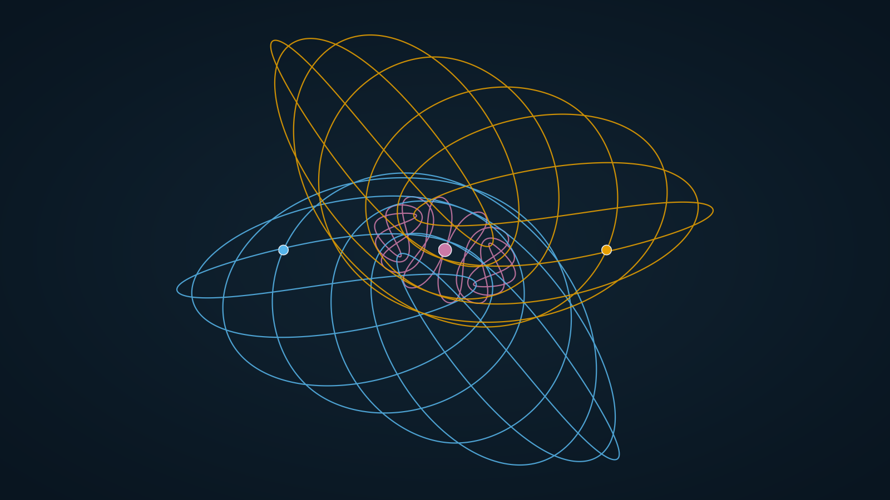
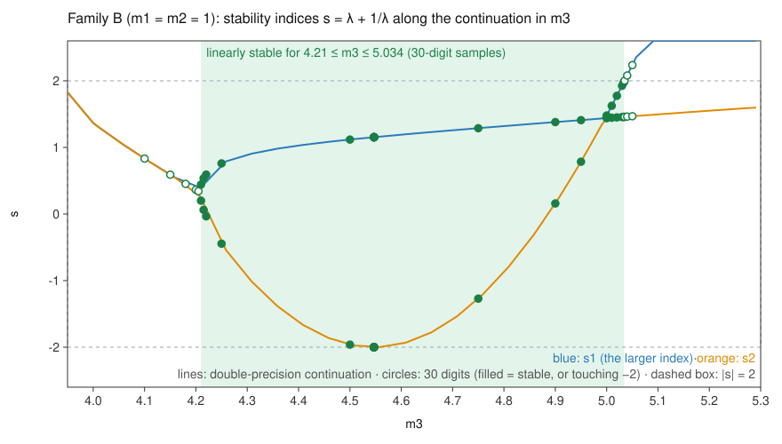
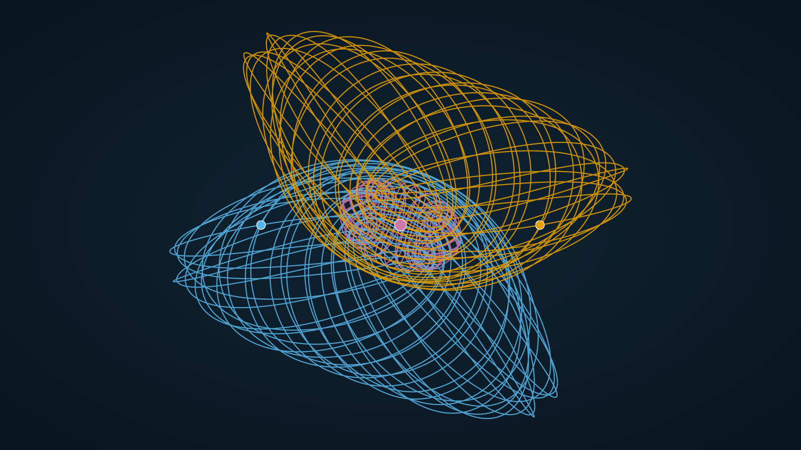

# Family B: a linearly stable family of planar periodic three-body orbits whose topology is not in the published lists

[](https://doi.org/10.5281/zenodo.23987401)

Felix Habl. Code and computations written with Claude, an AI model by Anthropic. Companion to the search engine [dreikoerper](https://github.com/Ne0nk3k/dreikoerper) ([doi:10.5281/zenodo.23536576](https://doi.org/10.5281/zenodo.23536576)).

## Summary

Planar three-body problem, G = 1, zero angular momentum, masses m1 = m2 = 1 and m3 variable, isosceles collinear (Euler) initial conditions in the convention of Li & Liao: r1 = (−1, 0), r2 = (1, 0), r3 = (0, 0); v1 = v2 = (a, b); v3 = −(2/m3) (a, b).

**Family B** is a one-parameter family of symmetric periodic orbits with the free-group word `ABABABAbabababaB` (16 letters). It is **linearly stable for m3 from 4.21 to 5.034** (30-digit samples; the boundaries lie between 4.205 and 4.21 and between 5.034 and 5.035); at one mass inside, m3 ≈ 4.5468718, one index touches −2 without crossing it. Its word occurs in none of the published lists we checked, at any mass. At m3 = 5:

```
m1 = m2 = 1, m3 = 5
a  = 0.79623821011254661853007106578327
b  = 1.77433055827060488061484304997624
T  = 19.25669842976743050033657405267752
T* = T |E|^1.5 = 228.6626   (E = -5.2049)
```

- **Stability indices** (λ + 1/λ, 30 digits): 1.479156039545 and 1.439113975475.
- **Return distance** of exactly these digits after one period: 1.953e-30 at 320 bits, 1.953e-30 at 448 bits. It comes from rounding the initial values to 32 digits, not from the integration: before rounding, the Newton residual is 4.623e-37.
- **Closest approach** of two bodies: 0.0166 at m3 = 5 (0.009 to 0.026 along the continuation).



*One period at m3 = 5, computed with `kern.js` from the values above (the orbit closes to 5.6e-12 in double precision). Blue and orange: the bodies of mass 1; pink: the body of mass 5; the dots mark the starting configuration.*

## Stability along the family



The family was continued in m3 from 3.949 to 10.000 (double precision, `daten/family-B-continuation.csv`); the free-group word stays the same throughout. Stability was then computed at 30 digits at 32 masses (`daten/family-B-30digit.csv`):

| m3 | verdict at 30 digits | indices |
|---|---|---|
| 4.205 | unstable (complex pair) | 0.342445 ± 0.160724 i |
| 4.21 | stable | 0.442052 / 0.199937 |
| 5 | stable | 1.479156 / 1.439114 |
| 5.034 | stable | 1.987026 / 1.458740 |
| 5.035 | unstable | 2.002383 / 1.459314 |

Between 4.21 and 5.034 all 24 samples have both indices real and in [−2, 2): 22 are stable with a margin above 1e-15, 2 (m3 = 4.54687176 and 4.546871764769) are closer to −2 than that, with a positive margin (next paragraph). All 20 points of the double-precision continuation in that range are stable too (spaced at most 0.05 apart). Below the lower boundary the two indices form a complex pair, so the four nontrivial multipliers lie off the unit circle; at the upper boundary s1 crosses +2.

**One index touches −2 without crossing it.** Family B has a half-period symmetry: after half a period the state is the mirror image of the initial state, x(T/2) = g x(0), where g is a reflection of the plane combined with a rotation; no bodies are exchanged. Since g maps solutions to solutions, x(t + T/2) = g x(t) for all t, and the monodromy matrix is a square: M = N² with N = g · DΦ(T/2). Each nontrivial index is then s = σ² − 2, with σ the corresponding index of N. While the two indices are real and distinct, as here, both σ are real and s ≥ −2: an index can touch −2 but cannot pass below it. `halbperiode.mjs` checks this in double precision at all 32 samples of the 30-digit table: |g x(0) − x(T/2)| ≤ 4.1e-11 (for the best other g at least 1.70), |N² − M| / |M| ≤ 1.1e-8 (without g, or with the other g, at least 4.4).

Near m3 = 4.5468717648 the index s2 comes down to −2. The 30-digit margin is 1.919e-24 at m3 = 4.546871764769, 4.032e-16 at 4.54687176 (4.77e-9 away) and 9.811e-13 at 4.546872 (2.35e-7 away). Both neighbours give the same curvature, margin ≈ k (m3 − m*)² with k = 17.73 and 17.73: the quadratic touch that σ passing through zero produces. So there is no unstable sliver; at a single mass the index equals −2.

## Why we think this topology is not in the published lists

1. **Word comparison over all masses.** The word was compared up to relabelling of all three bodies, cyclic shift and time reversal with Li & Liao (2017), Li, Jing & Liao (2018, all seven masses), Šuvakov & Dmitrašinović (2013), and the databases of Hristov et al. (441,985 equal-mass initial conditions; words computed for 441,956 of them, 308,333 distinct). It occurs in none of them.
   - *Calibration:* our words reproduce 1346 of the 1349 published words of Li, Jing & Liao (2018) letter for letter (up to cyclic shift); of the other three, two (II.D-1, II.D-2) are written without free reduction in the list and reduce to the word we compute; in one (I.B-33) the list word lacks one letter of ours. The 2048 listed orbits recomputed from their initial conditions give the stored class in 2047 cases, and 1408 of 1408 of our own orbits that match a listed orbit by position or T* also find their word in the lists.
2. **Not a satellite of a shorter orbit.** A satellite winds k times almost along a shorter orbit, so its word is almost a k-fold repetition. Compared letter by letter, at every cyclic shift and in both directions, the closest k-fold repetition (k = 2 … 8 dividing the length) differs from family B's word in 8 of its 16 letters (k = 2). The satellite rule used in our searches allows at most 4; all 215 of 215 satellites recognised in our runs lie within it.
3. **Not a free-fall orbit.** The kinetic energy never drops below 20.2 % of |E|; orbits in free-fall lists come to rest once per period (check on 3 free-fall orbits of Li & Liao 2019: minimum ≈ 1e-12).
4. **Continuation.** Continued from m3 = 3.949 to 10.000, the family keeps its word. At the other masses on the way for which a list exists (m3 = 4, 8, 10) it is not in the list either (85, 17, 9 orbits).
5. **Other collections.** The atlas threebodyorbits.com contains, for these masses, exactly the orbits of Li, Jing & Liao (2018). The 135,445 orbits of Li, Li & Liao (2021), 13,315 of them stable, have masses between 0.7 and 1.2, so none has the ratio 1 : 1 : 5. A literature search (October–November 2026) found no newer list for this configuration.

**Limits of this claim.** "Not in the lists" means: not in the lists we know and checked. Hristov et al. cover equal masses only (T* < 211). Li, Jing & Liao list one orbit per class; all 35 orbits they list at these masses lie in the square 0 < a, b < 1 (at all seven masses, all but 3 of 1349). Family B lies outside that square (at m3 = 5, b = 1.774). Our search finds symmetric orbits only.

## A second candidate: family A

```
m1 = m2 = 1, m3 = 5
a  = 0.82018322961567751340828569691800
b  = 1.75101514196027976882260233210670
T  = 78.23894907327765606161703540397501
T* = 945.3934   (E = -5.2657)
```



*One period of family A at m3 = 5 (closes to 2.4e-9 in double precision); colours as above.*

Stability indices at 30 digits 0.8465902880 and -0.6944077848 (margin 1.15); return distance of these digits 6.022e-30 at 320 bits and 6.022e-30 at 448 bits. Word of 66 letters, in no list; nearest repetition 22 letters off; kinetic energy never below 20.7 % of |E|. Its bodies come as close as 0.00015, so double precision cannot judge its stability; at 30 digits it is stable at 4.9, 4.95, 5, 5.05, 5.1. Its stability window is not determined (`daten/family-A-30digit.csv`, `daten/family-A-continuation.csv`). Family A has a half-period symmetry too, with the two bodies of mass 1 exchanged (|N² − M| / |M| ≤ 1.6e-4 at all 5 samples, other readings at least 4.2).

## Check it yourself

Node.js 18 or later, no packages:

```
node bahn-pruefen.mjs --m 1,1,5 --a 0.79623821011254661853007106578327 --b 1.77433055827060488061484304997624 --T 19.25669842976743050033657405267752
node alle-pruefen.mjs daten/family-B-30digit.csv
node halbperiode.mjs --m 1,1,5 --a 0.79623821011254661853007106578327 --b 1.77433055827060488061484304997624 --T 19.25669842976743050033657405267752
```

The first line integrates one period at 320 and at 448 bits and computes both stability indices (about one and a half minutes for family B on one core). The second repeats this for every row of the table and compares verdicts and indices with the table. The third checks the half-period symmetry and M = N² in double precision (0.3 s for family B, measured). The search, the list comparisons and the continuation tools are in the main project (`werkzeug/massen-fortsetzung.mjs`, `werkzeug/familien-abgleich.mjs`, `werkzeug/fast-vielfach.mjs`, `werkzeug/stillstand.mjs`).

## Files

| File | Content |
|---|---|
| `daten/family-B-30digit.csv` | 30-digit initial conditions and stability at every sampled mass |
| `daten/family-B-continuation.csv` | the continuation in m3, double precision |
| `daten/family-A-30digit.csv`, `daten/family-A-continuation.csv` | the same for family A |
| `bilder/` | the orbits at m3 = 5 and the stability diagram |
| `bahn-pruefen.mjs`, `halbperiode.mjs`, `genau.mjs`, `kern.js`, `quellen.mjs` | the verification code, taken unchanged from the main project |
| `alle-pruefen.mjs` | runs `bahn-pruefen.mjs` on every row of a table (written for this repository) |

## How to cite

Habl, F. (2026). Family B: a linearly stable family of planar periodic three-body orbits whose topology is not in the published lists. Zenodo. [doi:10.5281/zenodo.23987401](https://doi.org/10.5281/zenodo.23987401)

## References

- Li X, Liao S (2017). More than six hundred new families of Newtonian periodic planar collisionless three-body orbits. Sci. China Phys. Mech. Astron. 60, 129511. doi:10.1007/s11433-017-9078-5
- Li X, Jing Y, Liao S (2018). Over a thousand new periodic orbits of a planar three-body system with unequal masses. Publ. Astron. Soc. Japan 70, 64. doi:10.1093/pasj/psy057
- Li X, Liao S (2019). Collisionless periodic orbits in the free-fall three-body problem. New Astronomy 70, 22-26. doi:10.1016/j.newast.2019.01.003
- Šuvakov M, Dmitrašinović V (2013). Three classes of Newtonian three-body planar periodic orbits. Phys. Rev. Lett. 110, 114301.
- Hristov I, Hristova R, et al. Databases of periodic three-body orbits, db2.fmi.uni-sofia.bg; arXiv:2404.16526, arXiv:2308.16159, arXiv:2510.22802.
- Li X, Li X, Liao S (2021). One family of 13315 stable periodic orbits of non-hierarchical unequal-mass triple systems. Sci. China Phys. Mech. Astron. 64, 219511. doi:10.1007/s11433-020-1624-7
- Habl F (2026). dreikoerper: a search engine for periodic orbits of the planar three-body problem, and its finds. Zenodo. doi:10.5281/zenodo.23536576

## License

Data and text: [CC BY 4.0](https://creativecommons.org/licenses/by/4.0/). Code: MIT (see `LICENSE`).
